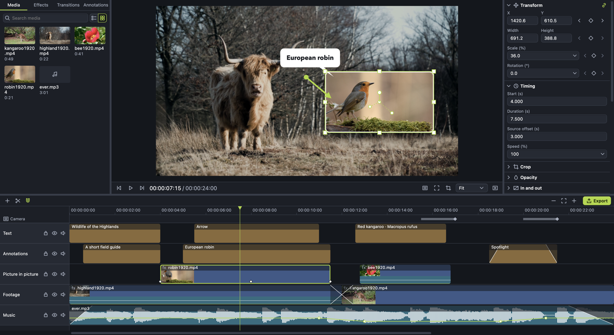
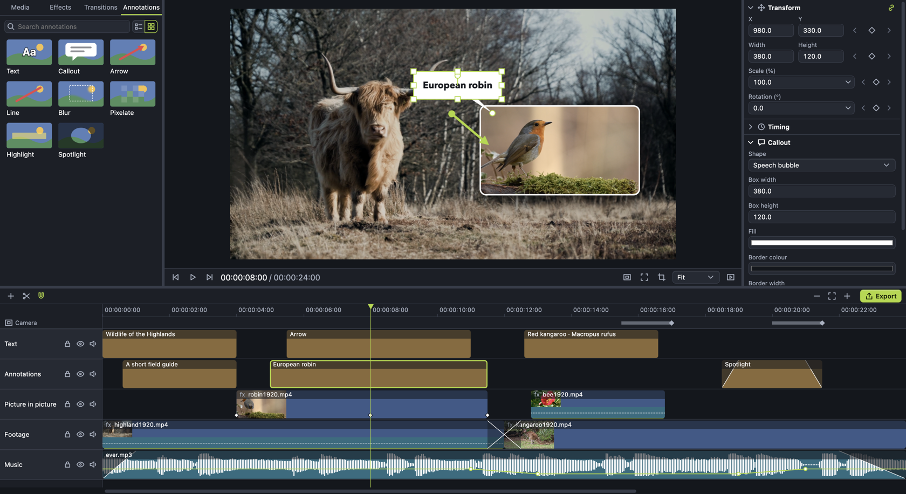
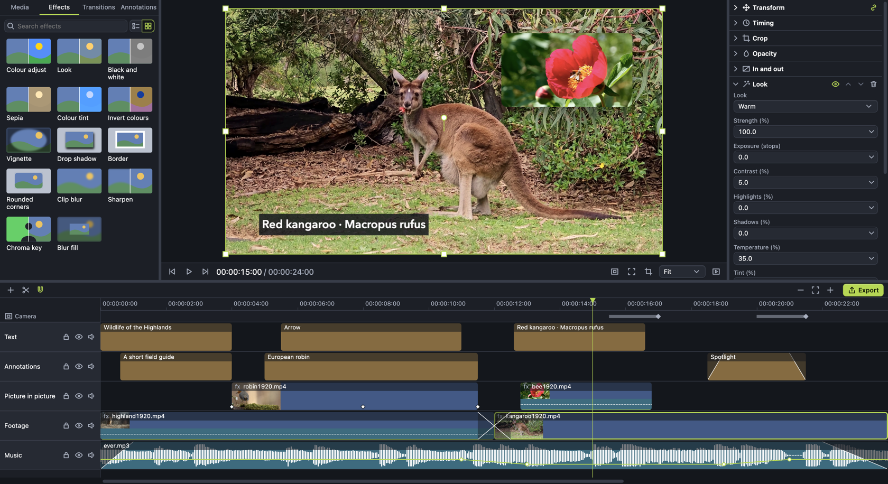
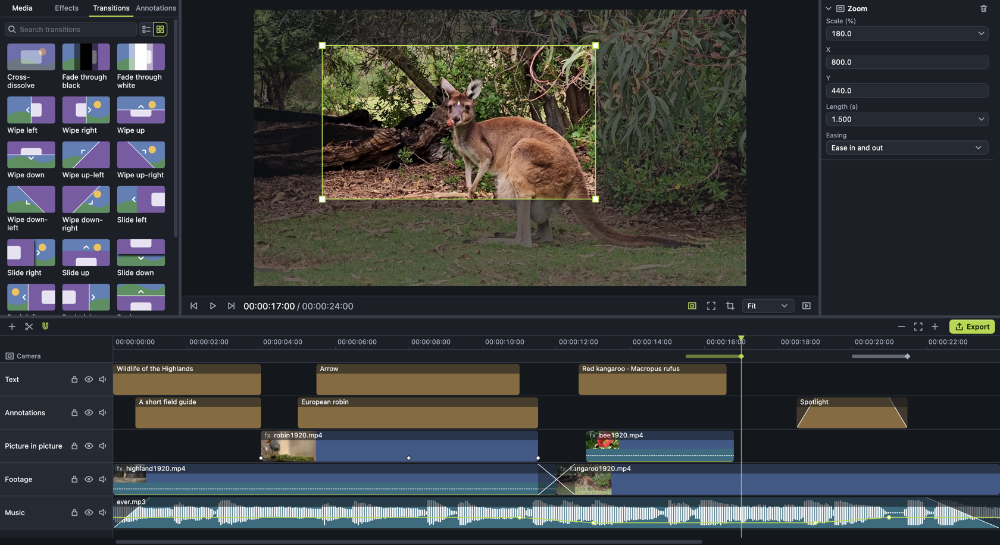
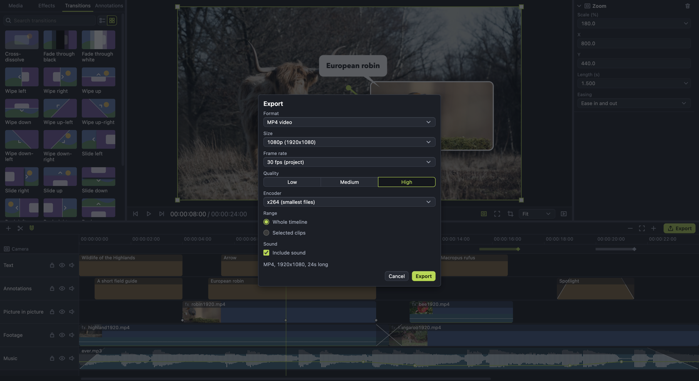

# video-editor
Lightweight video editor for macOS on Apple silicon, written in TypeScript with Electron, React, WebGL2 and FFmpeg. Edit videos with a multi-track timeline, keyframes and a zoom-and-pan camera. For commandline video editor check my previous project [json-to-ffmpeg](https://github.com/pilotpirxie/json-to-ffmpeg).

### Features
* Multi-track timeline, any clip on any track
* WYSIWYG canvas with handles to move, scale, rotate and crop
* Keyframes with easing and motion paths
* Zoom and pan camera, set by drawing a frame on the canvas
* Text, callouts, arrows, highlights, spotlights, blur and pixelate
* Transitions, effects and animation presets
* Snapping, split, ripple edits and groups
* Speed from 1% to 50,000% and volume keyframes
* Export to MP4, WebM, GIF, M4A, MP3, WAV and PNG
* Shortcuts, rebindable
* Works fully offline











### Usage
You can download bundled DMG or build from the source code.

Needs Node 24 and macOS on Apple silicon.
```shell
git clone https://github.com/pilotpirxie/video-editor.git
cd video-editor
npm ci
npm start
```

## Video, audio and image test samples
All samples are from [Pixabay](https://pixabay.com/). All samples are licensed under [Pixabay License](https://pixabay.com/service/license/).

* https://pixabay.com/videos/cow-ruminant-pasture-meadow-nature-186195/
* https://pixabay.com/videos/book-pages-literature-beach-ocean-185096/
* https://pixabay.com/videos/flower-peony-bee-insect-pollinate-165065/
* https://pixabay.com/videos/kangaroos-marsupials-mammal-181314/
* https://pixabay.com/videos/flower-dandelion-wild-flowers-72763/
* https://pixabay.com/videos/highland-cows-cows-cattle-scotland-65903/
* https://pixabay.com/videos/robin-bird-forest-nature-spring-21723/
* https://pixabay.com/music/beats-weeknds-122592/
* https://pixabay.com/music/future-bass-ever-flowing-12277/


### License
```
GPL-3.0-or-later
```